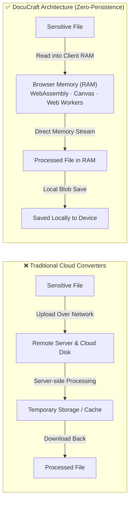

# DocuCraft — Privacy-First Document & Image Studio

[](https://toolsdoc.vercel.app/)
[](LICENSE)
[](https://taufiqu.vercel.app/)
[](https://toolsdoc.vercel.app/)
[](https://toolsdoc.vercel.app/)

> **DocuCraft** is an open-source, privacy-first document and image suite designed to execute **100% locally in browser memory (RAM)**. No files are ever uploaded to any third-party server, cloud database, or analytics bucket.

---

## 🌐 Live Web Application

Experience the studio live in your browser:  
👉 **[https://toolsdoc.vercel.app/](https://toolsdoc.vercel.app/)**

---

## 🛡️ Why DocuCraft? (Privacy by Architecture)

Most traditional online document converters require you to upload confidential files (national ID / KTP, pay slips, bank statements, legal contracts, NDAs) to remote servers where they are saved as temporary files on disk and processed in the cloud.

DocuCraft fundamentally changes this model:



### Privacy & Architecture Comparison

| Feature | Conventional Online Converters | DocuCraft Studio |
| :--- | :--- | :--- |
| **File Destination** | Uploaded to third-party server | **Stays 100% in local device RAM** |
| **Server Persistence** | Files stored in cloud temp disk | **Zero server storage, zero disk writes** |
| **Data Leak Risk** | High (third-party breaches, server logs) | **Zero (no server receiving network payload)** |
| **Offline Capability** | ❌ Requires continuous active connection | **✅ Works 100% offline once web app loads** |
| **Cost & Limits** | Subscriptions, paywalls, queue limits | **100% Free & Open-Source (MIT)** |

---

## ✨ Key Architectural Highlights

- **🔒 100% Client-Side & Zero-Telemetry:** All file transformations run locally in browser RAM via WebAssembly (OpenCV.js), HTML5 Canvas, and client-side binary parsers.
- **⚡ Offline-First Architecture:** Once loaded, the web app functions completely without an active internet connection.
- **👁️ In-Browser Computer Vision:** Document scanning, corner detection, and 4-point perspective warp run directly in browser memory via OpenCV.js compiled to WebAssembly.
- **📂 Recursive Folder Ingestion:** Drag-and-drop entire directory trees with recursive scanning and natural alphanumeric sorting (`1.pdf`, `2.pdf`, `10.pdf`).
- **☁️ Google Drive Direct Stream:** Import files directly via Google Picker API, streaming payloads straight into client RAM without intermediary proxy servers.
- **🖥️ Multi-Target Ecosystem:** Available as a lightweight Web SPA, an installable offline Desktop App (via PWA with zero SmartScreen friction), and a headless Python CLI engine.

---

## 🛠️ Active Modules (22+ Studio Tools)

### 1. 🛡️ Security, Privacy & Legal Studio
| Module | Capabilities |
| :--- | :--- |
| **PDF Signer & E-Materai** | Place digital signatures, official company stamps, and E-Materai stamps with pixel-perfect precision directly in browser RAM. |
| **PDF Redact (Privacy Blackout)** | Permanently redact and sanitize sensitive text (NIK KTP, bank account numbers, addresses, confidential clauses) with anti-leak guarantee. |
| **PDF Watermark** | Stamp diagonal or horizontal semi-transparent watermark text with custom opacity, rotation, and scale. |

### 2. 📸 Scanner & Computer Vision Studio
| Module | Capabilities |
| :--- | :--- |
| **CamScanner Web (OpenCV.js)** | Capture document photos, auto-detect document contours, perform 4-point perspective transform, apply Magic Color & B&W photocopy filters, and compile to PDF. |
| **QR Code Studio** | Generate custom high-contrast QR codes and decode/scan QR codes live via device camera or local image input without server uploads. |

### 3. 📄 PDF Core Operations
| Module | Capabilities |
| :--- | :--- |
| **Page Organizer** | Visual drag-and-drop page reordering, 90°/180°/270° orientation rotation, and individual page removal. |
| **PDF Merger** | Concatenate multiple PDF files or entire folders with standardized paper presets (A4, F4 Folio, US Letter). |
| **PDF Splitter** | Extract individual pages into single PDFs or split documents by custom interval ranges (e.g. `1-3, 5-8`). |
| **PDF Compressor** | Reduce PDF weights in RAM with *Extreme*, *Recommended*, and *Mild* downsampling presets. |
| **Page Numbering** | Stamp Arabic and Roman page indices into headers or footers with custom offsets, alignment, and cover page skips. |
| **Grayscale & B&W PDF** | Convert color documents to clean monochrome pages with contrast tuning to clean scan artifacts and reduce print ink. |

### 4. 📑 Office & Cross-Format Conversion
| Module | Capabilities |
| :--- | :--- |
| **PDF to Word (.docx)** | Reconstruct PDF layouts into editable Microsoft Word documents locally in browser RAM (tables, font weights, paragraphs). |
| **Compress Office** | Downsample and compress Word (`.docx`), PowerPoint (`.pptx`), and Excel (`.xlsx`) files directly in browser memory without sending data to servers. |
| **Extract Images** | Batch extract all embedded images, diagrams, and figures from PDF, Word, PowerPoint, and Excel documents into a organized ZIP archive. |
| **Translate Document** | Translate DOCX documents while preserving document structures, tables, formatting, and headers. |
| **Scribd to PDF** | Client-side vector compilation for public document viewing and archiving. |

### 5. 🖼️ Image & Media Tools
| Module | Capabilities |
| :--- | :--- |
| **Pas Foto & ID Studio** | Official administrative ID presets (**2×3, 3×4, 4×6, Paspor**) @ 300 DPI with instant Red/Blue background replacement and file size ceiling limits. |
| **Images to PDF** | Compile JPG, PNG, and WebP images into standardized multi-page PDF documents with Magic Scan enhancement filters. |
| **PDF to Images** | Rasterize PDF pages into high-resolution standalone PNG, JPG, or WebP images with 1-click batch download. |
| **Image Compressor** | Multi-file client-side image compression with custom quality, dimension bounds, and maximum file size thresholds. |
| **PNG to JPG Batch** | Convert transparent PNGs into lightweight JPGs with custom solid color background fills. |
| **Favicon & Web Icon Pack** | Generate multi-resolution `.ico` binaries and complete PWA icon suites (Apple Touch, Android Chrome, web manifest, HTML head tags). |

---

## 🧰 Technology Stack

- **Frontend & UI:** React 18, TypeScript, Tailwind CSS, Lucide Icons, Vite
- **Offline & Desktop Runtime:** Progressive Web App (PWA) with Service Worker & Workbox precaching
- **Document & Binary Engines:** `pdf-lib`, `pdfjs-dist`, `docx`, `jszip`, `file-saver`
- **Computer Vision & WebAssembly:** `@techstark/opencv-js` (OpenCV WebAssembly), `@zxing/browser`
- **CLI Engine:** Python 3.10+ (PyMuPDF / FitZ, pdfplumber, python-docx, Pillow)

---

## 🚀 Quick Start

### 1. Web & Desktop PWA (1-Click Install)

DocuCraft is a fully installable **Progressive Web App (PWA)**:
- Open [toolsdoc.vercel.app](https://toolsdoc.vercel.app/) in Chrome, Edge, or Brave.
- Click the **Install App** button in the top navigation bar or browser address bar.
- DocuCraft installs directly to your **Windows Start Menu, Taskbar, and Desktop** without any SmartScreen warnings, running 100% offline in a standalone window.

To run locally in development:
```sh
# Clone repository
git clone https://github.com/Taufiqu/document-tools.git
cd document-tools/web

# Install dependencies
npm install

# Start local development server
npm run dev
```
Open `http://localhost:5173` in your browser.

```sh
# Build production bundle (includes PWA service worker & manifest)
npm run build
```
The optimized bundle in `web/dist/` is ready for zero-config deployment on Vercel, Netlify, or GitHub Pages.

---

### 2. Python CLI Engine

DocuCraft also includes an autonomous Python CLI engine for headless scripting and automated terminal pipelines:

```sh
# Setup virtual environment
python3 -m venv .venv
source .venv/bin/activate  # On Windows: .venv\Scripts\activate
pip install -e '.[phase1,phase2,dev]'

# View all CLI commands
document-tools --help
```

Detailed CLI documentation is available in:  
📖 **[docs/CLI_REFERENCE.md](docs/CLI_REFERENCE.md)**

---

## 👤 Author & Creator

Designed and engineered with ❤️ by **Taufiqu**:
- 🌐 **Portfolio:** [https://taufiqu.vercel.app/](https://taufiqu.vercel.app/)
- 💼 **LinkedIn:** [https://www.linkedin.com/in/taufiqu/](https://www.linkedin.com/in/taufiqu/)
- 🐙 **GitHub:** [@Taufiqu](https://github.com/Taufiqu)
- 🚀 **Live Studio:** [toolsdoc.vercel.app](https://toolsdoc.vercel.app/)

---

## 📄 License

This project is open-source and licensed under the **[MIT License](LICENSE)**.

Copyright © 2026 **Taufiqu**. All rights reserved.
